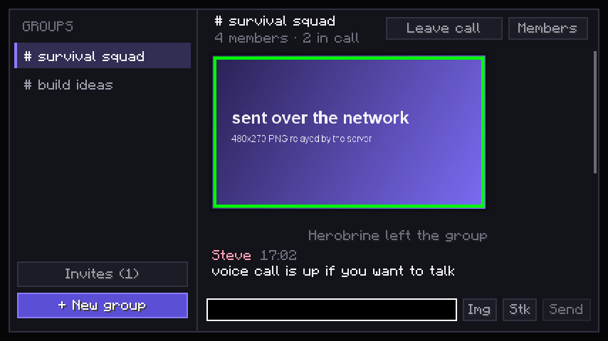
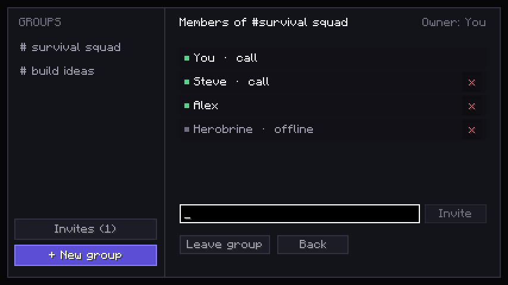
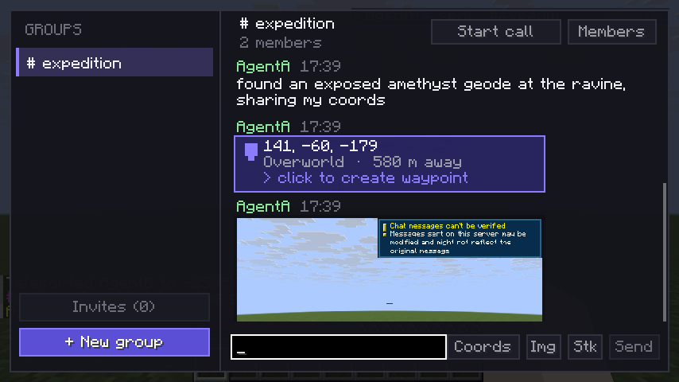
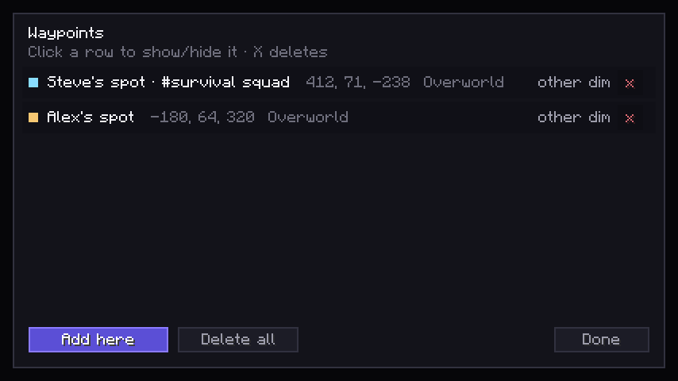
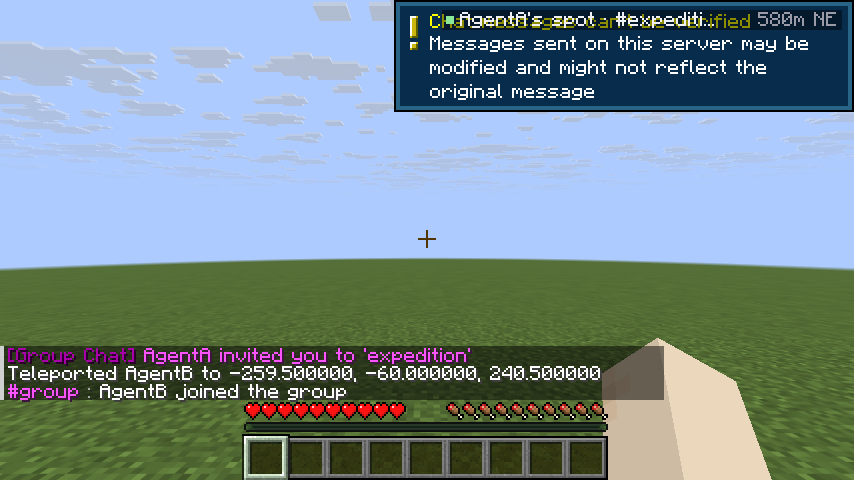

# Group Chat — Discord-style group chats inside Minecraft

A Fabric mod for **Minecraft 1.21.11** that adds private group conversations: create groups,
invite players, chat in a dedicated GUI, send images and stickers, and hop on a voice channel
— all over the normal Minecraft connection, so there are no extra ports, servers or accounts.

Everything runs **server-authoritative**: the server (or the integrated server in single player)
owns groups, membership, invites, history and images.



## Features

| | |
| --- | --- |
| **Groups** | up to 16 members per group, multiple groups per player, owner can remove members |
| **Invites** | invite anyone online, invites show up in-game with Accept / Decline |
| **Chat GUI** | `G` opens a two-pane hub: group list, unread badges, message bubbles, timestamps, scrolling |
| **Images** | send PNG/JPG/GIF/BMP — drag & drop onto the window, the built-in image browser, or copy them into `config/groupchat/images` |
| **Stickers** | bundled pack (`smile`, `laugh`, `sad`, `cool`, `heart`, `star`, `creeper`, `diamond`, `party`) |
| **Share coordinates** | one **Coords** button posts your position + dimension; **click the message to turn it into a waypoint** |
| **Waypoints** | client-side list (`B`), live HUD with distance + compass bearing, persisted in `config/groupchat/waypoints.json` |
| **Voice calls** | push-to-talk voice channels per group, mixed so several people can talk at once |
| **Notifications** | new messages are echoed to the chat HUD with a sound when the hub is closed |
| **Persistence** | groups + history are stored in the world folder, images on disk, all survive restarts |
| **Commands** | everything the GUI does is also available as `/gchat ...` |

## Install

Requires **Minecraft 1.21.11**, **Fabric Loader 0.20.1+** and **Fabric API 0.141.6+1.21.11**
(or newer). Java 21.

1. Drop `groupchat-1.0.0.jar` into `.minecraft/mods`.
2. Do the same on the server (the mod must be on the server; clients without it can still play,
   they just don't see the chat).

Grab the build with:

```bash
./gradlew build          # -> build/libs/groupchat-1.0.0.jar
```

## Using it

| Action | How |
| --- | --- |
| Open the hub | `V` (rebindable: Options → Controls → Multiplayer) |
| Create a group | `+ New group` in the sidebar → name it → tick players → `Create` |
| Invite someone | `Members` → type a name → `Invite`, or `/gchat invite <player> <group>` |
| Accept an invite | `Invites (n)` in the sidebar → `Accept` |
| Send a message | type in the box, `Enter` |
| Send an image | `Img` (built-in browser) or **drag & drop** an image file on the window |
| Send a sticker | `Stk` |
| Share coordinates | `Coords` — posts your position to the group |
| Create a waypoint | **click a shared-coordinate message** in chat |
| Waypoint list | `B` |
| Voice | `Start call` / `Join call` in the header, then **hold `N`** to talk |
| Mute / leave | `Leave call` in the header (also mutes the mic for others) |
| Switch group | `Tab`, or click in the sidebar |
| Close / back | `Esc` (once per panel) |

Messages written with `/gchat msg <group> <text>` are relayed like normal ones, so you can chat
without opening the GUI.



### Sharing coordinates → waypoints

1. Stand somewhere interesting and press **`Coords`** in the composer. The group instantly gets a
   message like `141, -60, -179 · Overworld · 580 m away`.
2. Anyone in the group **clicks that message** and a waypoint appears in their own list.
3. Waypoints show up in the top-right HUD with distance and compass bearing
   (`AgentA's spot · #expedition  580m NE`), and in the `B` screen where you can hide, delete or add
   the spot you are standing on.






Waypoints are per-client: the server only relays the coordinate message, so each player decides
what to keep. Clicking the same message twice does nothing (duplicates within 2 blocks are ignored).

### Voice chat details

* 16 kHz mono, 40 ms frames, IMA-ADPCM 4:1 → about **8 KB/s per speaker**.
* Frames are relayed by the server only to members that joined the call.
* Push-to-talk with a noise gate; the header shows `muted` / `talking` / `hold N to talk`.
* Playback mixes every speaker into a single output line, so overlapping speech works.
* If no microphone or speakers are available the call still joins (listen-only) and the reason is
  logged; the client never leaves the mic open after being kicked or leaving the call.

## Commands

```
/gchat list                       your groups and pending invites
/gchat create <name>              create a group
/gchat invite <player> <group>    invite a player (group id or name)
/gchat accept <group>             accept an invite
/gchat decline <group>            decline an invite
/gchat leave <group>              leave (group is deleted when the last member leaves)
/gchat msg <group> <text...>      send a message without opening the GUI
/gchat call <group>               join the group's voice channel
/gchat hangup <group>             leave the voice channel
```

## Limits & storage

Client waypoints: `config/groupchat/waypoints.json`.

Server: `<world>/groupchat/groups.json` (groups, members, invites, last 200 messages per group)
and `<world>/groupchat/images/<groupId>/<imageId>.png` (max 96 images per group; the oldest are
evicted). Client: nothing is written outside `config/groupchat/images` (a drop folder).

| Limit | Value |
| --- | --- |
| members per group | 16 |
| message length | 900 characters |
| history kept per group | 200 messages |
| image size after conversion | 1.5 MB, scaled to max 1280 px |
| rate limits | 40 msgs / 10 s, 20 images / min, 30 invites / min, 2× frame rate for voice |

All of them live in `com.example.groupchat.Constants` if you want to tune them.

## How it works

```
client                        server (or integrated server)
  HubScreen ── C2S payload ──► ServerNet ── GroupManager ── groups.json
      ▲                            │            │
      └──── S2C payload ◄──────────┴────────────┴── ImageStore (PNG on disk)
                                   │
                          Voice relay (call members only)
```

* **Coordinate sharing** — `SendLocation` (C2S) is validated and clamped server-side, then stored as
  a normal message with kind `KIND_LOCATION` whose text is `dimension|x|y|z`, so coordinate messages
  survive history replay without any extra protocol state.
* **Transport** — one Fabric networking channel. Payload records live in `net/Payloads.java`,
  registered in `net/Protocol.java`. Image payloads use `registerLarge` so a 1.5 MB PNG is split
  into 30 KB packets automatically.
* **Server** — `GroupManager` (logic + JSON persistence), `ImageStore` (PNG validation, eviction),
  `ServerNet` (payload handlers + rate limits), `GcCommands` (Brigadier tree).
* **Client** — `ClientState` (mirror of the snapshot), `HubScreen` (all panels),
  `ImagePickerScreen` / `StickerPickerScreen`, `TextureCache` (image id → GPU texture, LRU),
  `VoiceClient` + `Adpcm` (capture, codec, jitter buffer, mixer).
* **Authority** — every mutation is validated server-side (membership, ownership, rate limits,
  payload sizes, PNG magic bytes). Clients cannot send to groups they are not in, and images can
  only be fetched by members of the owning group.

## Development

```bash
./gradlew build         # compile + package (jar + sources jar)
./gradlew runClient     # dev client
./gradlew runServer     # dev server (accept run/eula.txt on first run)
./gradlew genSources    # decompile Minecraft for navigation
```

### Scripted self-tests

The mod ships a dev-only harness (only active with `-Dgroupchat.devtools=true`) that is used to
verify the GUI and the protocol without clicking around:

```bash
# UI tour: seeds demo groups/messages/images, screenshots every panel -> run/groupchat-dev-N.png
./gradlew runClient -PgcDevtools=true

# Voice codec + audio device check (logs ADPCM round-trip SNR)
./gradlew runClient -PgcDevtools=true -PgcVoiceTest=true

# Live protocol test: joins a server, creates a group, sends text + sticker + image,
# screenshots the result -> run/groupchat-dev-9.png
./gradlew runServer                      # in one terminal (online-mode=false)
./gradlew runClient -PgcDevtools=true -PgcConnect=127.0.0.1:25565

# Two scripted players in one dedicated server (see run-agents/*.bat):
#   agent A: joins, teleports away, creates "expedition", invites B, chats, shares coords,
#            uploads a real in-game screenshot
#   agent B: accepts the invite, clicks A's coordinates into a waypoint, replies with its own
#            coordinates, screenshots the waypoint HUD
./gradlew runClient -PgcDevtools=true -PgcAgent=a -PgcConnect=127.0.0.1:25565
./gradlew runClient -PgcDevtools=true -PgcAgent=b -PgcConnect=127.0.0.1:25565
```

Verified with those: hub rendering, image scaling, sticker rendering, group creation, text and
sticker relay, image upload (large-payload splitting), server-side persistence, ADPCM round trip at
~22 dB SNR, and a full two-client session (A → server → B) for chat, coordinate sharing, waypoint
creation and cross-client image download.

## Known limitations

* Voice rides Minecraft's TCP connection. Latency is fine for chatting but it is not a
  UDP voice mod — a side-port transport is the natural next step.
* No moderation tooling beyond kick/leave, no mute lists, no message deletion or editing.
* History is capped at 200 messages per group (oldest are dropped, including image references).
* Stickers are the bundled pack; custom stickers are sent as regular images.
* Voice volume is fixed (per-member sliders are on the roadmap).
* Waypoints are HUD/list only — no in-world beam or minimap yet, and they are not shared between
  players (each player creates their own from the coordinate message).
* The server operator can read stored messages and images — same as any server-side chat mod.
